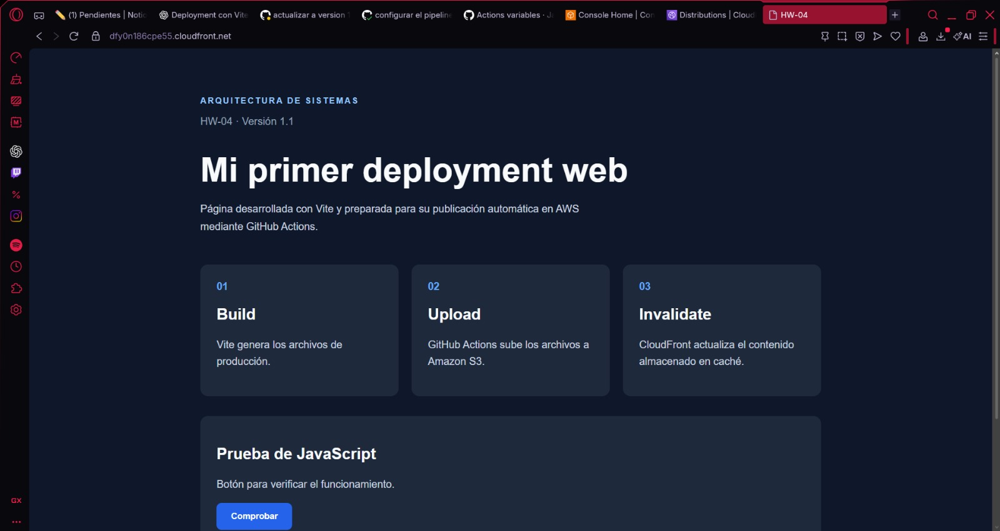
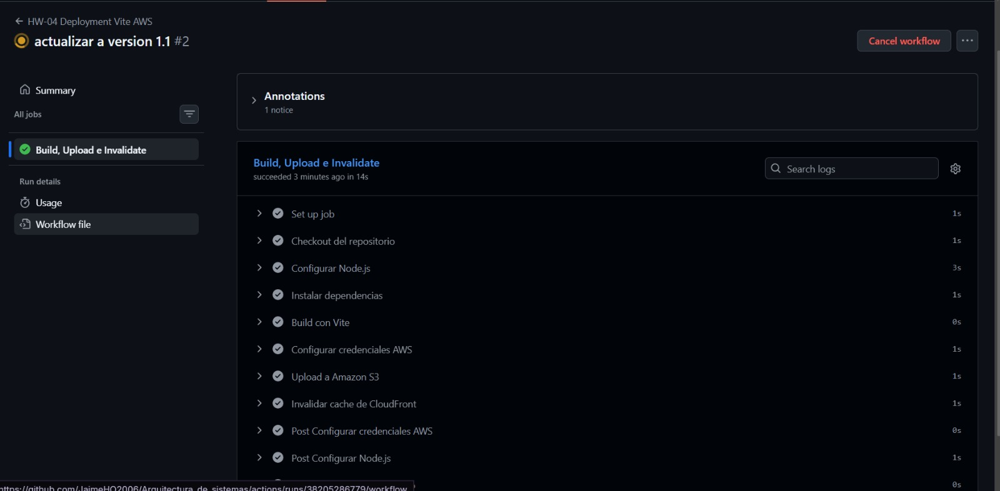
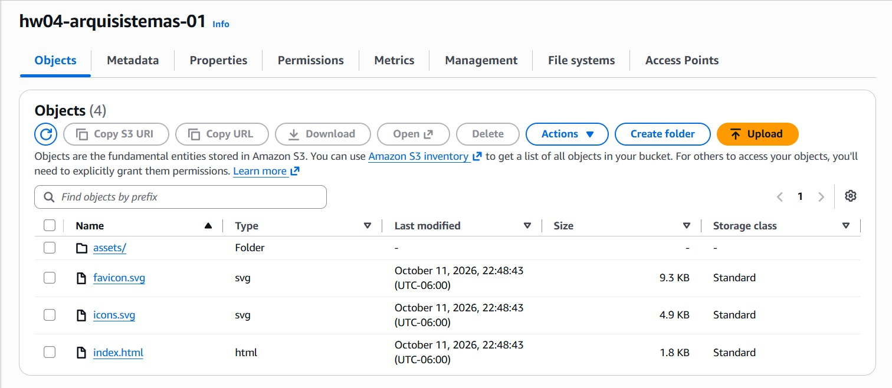

## Información
**Nombre:** Jaime Alejandro Hernandez Orozco
**Carnet:** 202408062
**Universidad:** Universidad Mesoamericana  
**Curso:** Arquitectura de sistemas  
**Profesor:** Jose Pablo Sanchez Estradad

## Descripción

Este repositorio contiene las tareas, prácticas y proyectos realizados durante el curso.
Cada práctica se desarrolla en una rama independiente.

En esta actividad desarolle una página web utilizando Vite, HTML, CSS y JavaScript. El objetivo fue implementar deployment automático mediante GitHub Actions, utilizando Amazon S3 para almacenar los archivos y Amazon CloudFront como CDN.

## Enlace a la pagina

*dfy0n186cpe55.cloudfront.net*

### Tecnologías utilizadas

**Vite:** desarrollo y construcción de la página web

**GitHub Actions:** automatización del deployment

**Amazon S3:** almacenamiento de archivos

**Amazon CloudFront:** distribución de contenido mediante CDN.

**AWS IAM:** administración de los permisos necesarios para el pipeline.

Funcionamiento del pipeline

El workflow está definido en .github/workflows/deploy.yml y se ejecuta automáticamente al realizar un git push a la rama hw-04.

## Evidencias

## Enlace a la pagina

*dfy0n186cpe55.cloudfront.net*