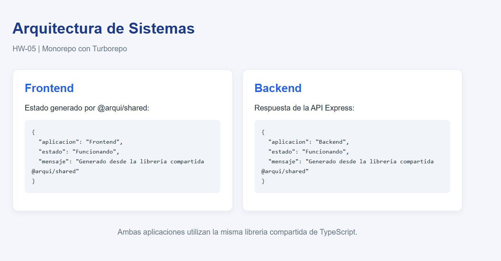
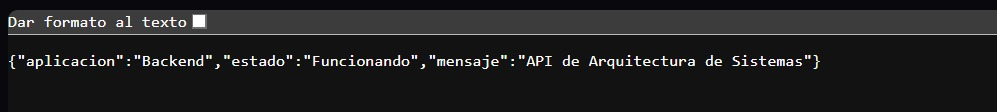
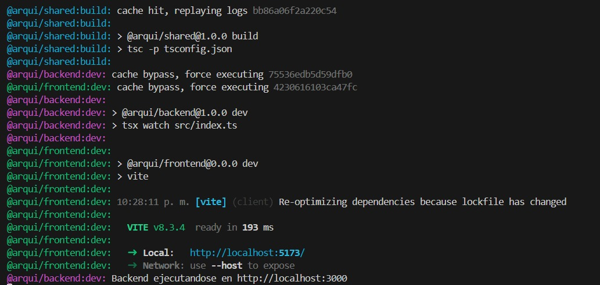
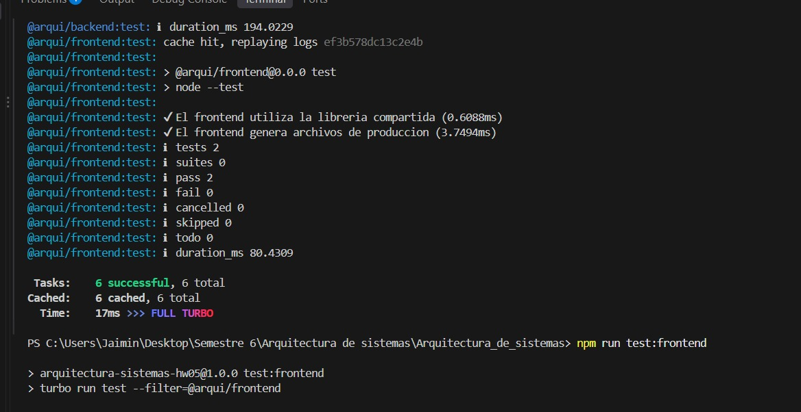

## Información
**Nombre:** Jaime Alejandro Hernandez Orozco
**Carnet:** 202408062
**Universidad:** Universidad Mesoamericana  
**Curso:** Arquitectura de sistemas  
**Profesor:** Jose Pablo Sanchez Estradad

## Descripción

Este repositorio contiene las tareas, prácticas y proyectos realizados durante el curso.
Cada práctica se desarrolla en una rama independiente.

## Descripcion del proyecto

En esta rama se implementa un monorepo que permita administrar varias aplicaciones y librerías compartidas.

El proyecto utiliza Turborepo y npm workspaces para gestionar un frontend desarrollado con Vite, un backend desarrollado con Express, y una librería compartida utilizada por ambas aplicaciones.

### Tecnologias utilizadas
- Turborepo
- npm
- Vite
- Express
- TypeScript
- Node.js

### Libreria Compartida
La librería @arqui/shared permite reutilizar código entre las aplicaciones.

Contiene la interfaz EstadoAplicacion y la función crearEstadoAplicacion(), que recibe el nombre de una aplicación y devuelve un objeto con su estado.

## Ejecucion desde 0
1. Clonar repositorio
*git clone https://github.com/JaimeHO2006/Arquitectura_de_sistemas.git*
2. entrar a la rama
*git switch hw-05*
3. Instalar dependencias
*npm ci*
4. Compilar todas las aplicaciones y librerías
*npm run build*
5. Ejecutar el monorepo
*npm run dev*
6. Acceder a las aplicaciones
*http://localhost:5173/*
*http://localhost:3000/api/status*

## Pruebas
El monorepo incluye pruebas automatizadas utilizando el módulo nativo de pruebas de Node.js.
Se comprueba lo siguiente:
- Librería compartida: generación correcta de estados para diferentes aplicaciones.

- Frontend: importación de la librería compartida y generación de archivos de producción.

- Backend: funcionamiento del endpoint GET /api/status y validación de su respuesta.

se pueden ejecutar con
npm run test

## Evidencia
### Frontend

### Backend

### Compilación

### Pruebas
